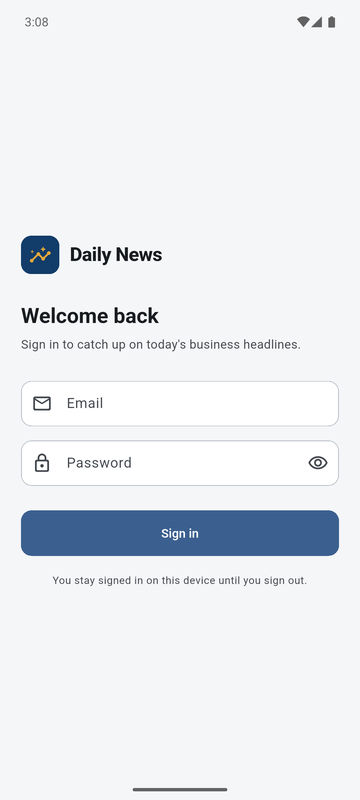
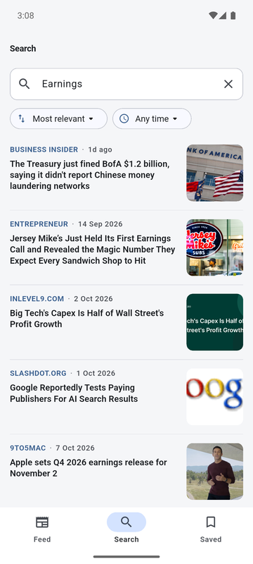
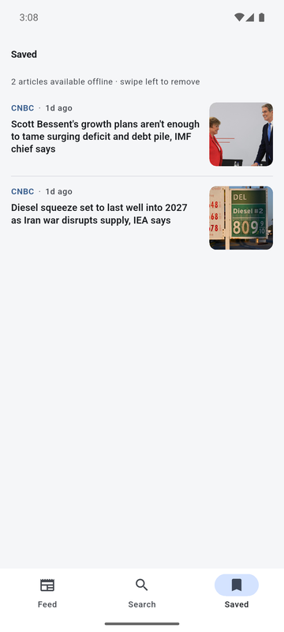

# Daily News

A small Flutter app for reading business news. You can browse headlines by
category, search for any topic, and save articles to read later, even without
internet.

It uses the free [NewsAPI.org](https://newsapi.org) API.

| Login | Feed | Article | Search | Saved |
| --- | --- | --- | --- | --- |
|  |  |  |  |  |

## What the app does

- **Login** – a simple local login. Any valid email and a password with at
  least 6 characters works. You stay logged in until you sign out (tap the
  avatar on the feed).
- **Feed** – top headlines, with Business as the default category. You can
  switch categories, pull down to refresh, and more articles load as you
  scroll.
- **Search** – search all news by keyword. Results start loading after you
  stop typing. You can sort by relevance, latest or popularity, and limit
  results to the past week or month. Recent searches are remembered.
- **Article page** – the image, title, author, date, summary and the part of
  the text that the API gives. A button opens the full story on the
  publisher's website.
- **Saved** – tap the bookmark on any article to save it. Saved articles are
  stored on the phone, so they still open when you are offline. Swipe left to
  remove one, and tap Undo if you change your mind.

It works in light and dark mode.

## How to run it

You need Flutter 3.x (I used 3.44) and a free API key from
[newsapi.org](https://newsapi.org/register).

1. Copy `env.example.json` to `env.json` and put your key in it:

   ```json
   {
     "NEWS_API_KEY": "your_key_here"
   }
   ```

2. Get the packages and run:

   ```bash
   flutter pub get
   flutter run --dart-define-from-file=env.json
   ```

`env.json` is in `.gitignore`, so the key never goes into git. If you use VS
Code, you can add `"toolArgs": ["--dart-define-from-file=env.json"]` to your
launch config and just press F5.

If you forget the key, the app still opens but shows "News API key is
missing" instead of the news.

To run the tests:

```bash
flutter test
```

## How the code is organised

I split the code by **feature** first, and then by **layer** inside each
feature. This keeps everything about one feature in one place, and new
features can be added without touching the others.

```
lib/
├── main.dart              starts Hive, then runs the app
├── app/                   app widget, routes, bottom navigation
├── core/                  shared code used by all features
│   ├── config/            reads the API key
│   ├── constants/         API urls, page size, timeouts
│   ├── error/             exceptions and failures
│   ├── network/           Dio setup and a small API client
│   ├── storage/           Hive setup
│   ├── theme/             colours and theme
│   ├── utils/             date formatting, form validation, snackbars
│   └── widgets/           error view, empty view, image, loading skeleton
└── features/
    ├── auth/
    ├── news/              feed and article page
    ├── search/
    └── favorites/
```

Every feature has the same three folders:

- **domain** – plain Dart. Entities (like `Article`), the repository
  interface, and use cases (like `GetTopHeadlines`). It does not know about
  Flutter, Dio or Hive.
- **data** – talks to the outside world. Models that read JSON, data sources
  for the API and Hive, and the repository implementation.
- **presentation** – screens, widgets and Riverpod providers.

The rule is simple: `presentation` uses `domain`, and `data` implements
`domain`. The domain layer does not import anything from the other two.

A request goes like this:

```
Screen → Controller (Riverpod) → Use case → Repository → Data source → NewsAPI / Hive
```

## Main decisions

**Riverpod without code generation.** I wrote the providers by hand. It is a
little more typing, but there is no build_runner step and it is easy to see
what each provider does. Screens use `AsyncNotifier` for anything that loads
data, so loading, error and data states come for free.

**Errors.** The data layer throws exceptions (`ServerException`,
`NetworkException`...). The repository turns them into a `Failure` with a
message that is fine to show to the user, for example "No internet
connection". The UI only ever deals with `Failure`. I did not use an
`Either` type because Riverpod's `AsyncValue` already holds the error.

**Hive for storage.** I used `hive_ce`, the maintained version of Hive,
because the original package is no longer updated. I store simple maps
instead of generated adapters, so there is no code generation here either.
Three boxes: the logged-in user, saved articles and recent searches. Saved
articles use a hash of the URL as the key, because Hive keys can't be longer
than 255 characters and some article URLs are.

**Pagination.** The feed and search share the same "load next page" logic
through a small mixin. If loading the next page fails, the articles you
already have stay on screen and a Retry button shows at the bottom.

**Search.** A few small things keep search fast and avoid wasted calls:

- it waits 450 ms after the last key press before searching
- when a new search starts, the old request is cancelled
- results for the same search are kept for 3 minutes, so going back to a
  previous search is instant

**Cleaning the API data.** NewsAPI returns some messy data, so the article
model cleans it up: it removes the " - Source name" at the end of titles,
removes the "[+1234 chars]" at the end of the content, and skips articles
marked as "[Removed]" or repeated in the same response.

## Limits of the free NewsAPI plan

These are not bugs in the app, but you will notice them:

- Only 100 results per query, so the feed and search stop after 5 pages.
- Search results are at least about a day old, and can't go back more than
  about a month. That is why there is no "past 24 hours" filter.
- The API only gives a short part of each article, so the article page has a
  button to read the full story on the publisher's site.
- Some publishers block their images from being loaded in other apps. Those
  articles show a plain placeholder instead.
- The free plan allows 100 requests a day.

## Tests

There are unit tests for each layer and two widget tests for the login
screen. They cover things like:

- parsing and cleaning the API response
- pagination, refresh and errors in the feed controller
- the search debounce and request cancellation
- saving, ordering and removing articles in Hive (using a temp folder)
- login validation and the session

## If I had more time

- Cache the feed in Hive too, so the last headlines show when you are offline
- Show related articles on the article page
- Add integration tests that run the full app
- Use a real backend for login
